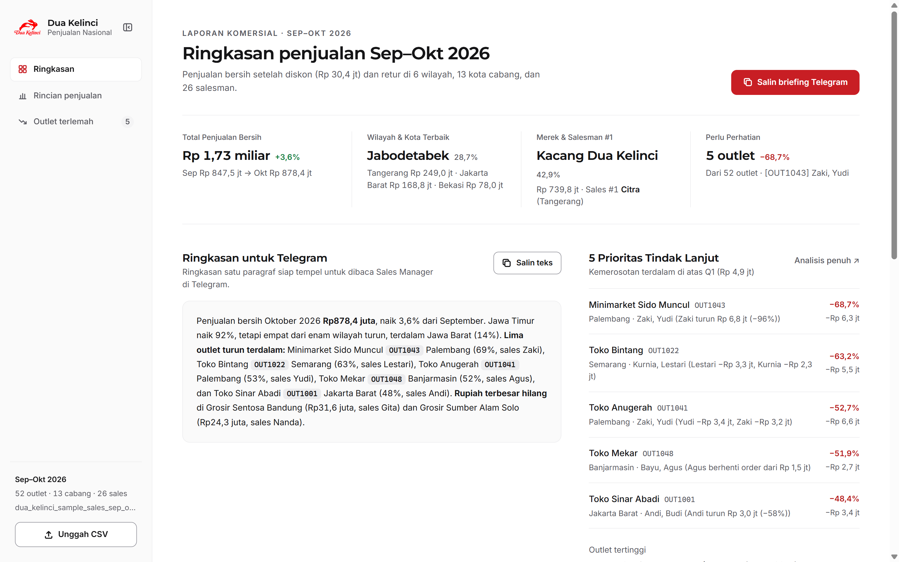

# Dua Kelinci Sales Dashboard

Three-page FastAPI web app that turns a 15-column sales CSV into a commercial summary with a one-paragraph Telegram update (`/`), sales tables by region, city branch, brand, and salesman (`/wilayah-merek`), and weakest-outlet analysis with SKU and salesman breakdown (`/outlet-terlemah`). All fonts, logos, and icons are bundled locally so the app runs offline.



| Rincian penjualan (Wilayah, Cabang, Merek, Salesman) | Outlet terlemah & panel detail SKU |
|---|---|
|  |  |

## Run locally

Requires Python 3.12+:

```bash
pip install -r requirements-dev.txt
python -m pytest
uvicorn app.main:app --reload
```

Open `http://127.0.0.1:8000` in your browser (JSON output at `http://127.0.0.1:8000/api/report`).

To try another CSV with the same 15 columns and at least two months of data, click **Unggah CSV** in the sidebar (accepts `,` or `;` UTF-8 CSV up to 10 MB) or start with `DATA_PATH=/path/to/sales.csv`.

## Run with Docker (optional)

```bash
docker compose up -d --build
```

Or with plain Docker CLI:

```bash
docker build -t dua-kelinci-sales .
docker run --rm -p 8000:8000 dua-kelinci-sales
```

To mount a custom CSV file into the container:

```bash
docker run --rm -p 8000:8000 \
  -v /path/to/sales.csv:/data/sales.csv:ro \
  -e DATA_PATH=/data/sales.csv \
  dua-kelinci-sales
```

## Documentation

- [docs/data.md](docs/data.md): 15-column CSV schema and cleaning rules
- [docs/metrics.md](docs/metrics.md): weakest-outlet rule (`Q1` minimum), SKU/salesman breakdown, and Telegram paragraph
- [docs/architecture.md](docs/architecture.md): data flow, routes, configuration, and Docker setup
- [docs/decisions.md](docs/decisions.md): key engineering and UI trade-offs
- [CHANGELOG.md](CHANGELOG.md): change history
