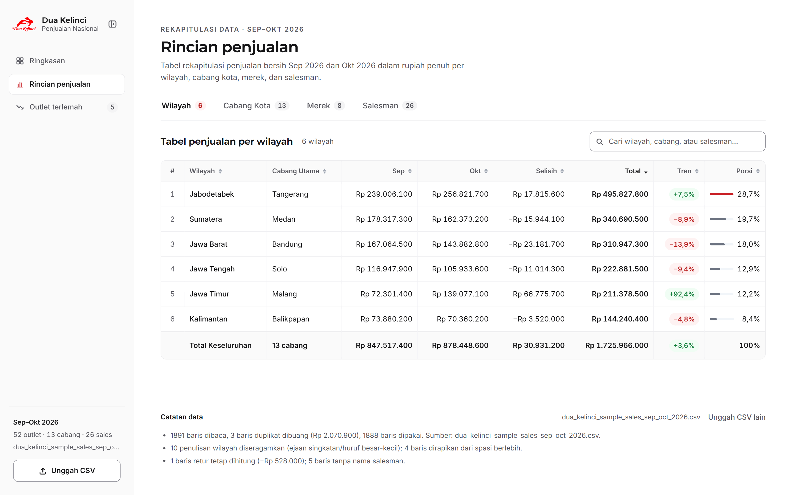
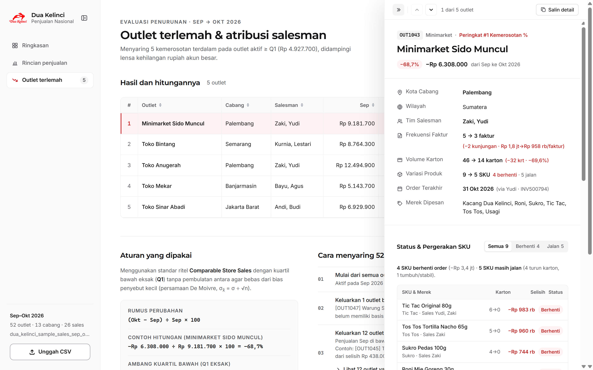

# Dua Kelinci Sales Dashboard

Three-page FastAPI web dashboard that turns a 15-column sales CSV into an executive summary with a copy-ready Telegram briefing (`/`), 4-dimension sales tables across region, city branch, brand, and salesman (`/wilayah-merek`), and weakest-outlet diagnostics with SKU movement and salesman attribution (`/outlet-terlemah`). All fonts, logos, and icons are self-hosted so the app runs completely offline.


| Rincian penjualan (Wilayah, Cabang, Merek, Salesman) | Outlet terlemah & Notion Side Peek (diagnostik SKU) |
|---|---|
|  |  |

## Deploy with Docker (recommended)

Docker is the recommended way to run this app. The image uses `python:3.14-slim`, runs as a non-root user (`appuser`, UID `10001`), and includes a built-in `/healthz` check.

### 1. Build and start the container

```bash
docker build -t dua-kelinci-sales .
docker run -d \
  --name dua-kelinci-sales \
  --restart unless-stopped \
  -p 8000:8000 \
  dua-kelinci-sales
```

Open `http://localhost:8000` in your browser.
- Health check: `http://localhost:8000/healthz` (`{"status": "ok"}`)
- JSON report API: `http://localhost:8000/api/report`

### 2. Load your own CSV data

You can supply another CSV (same 15 columns, at least 2 months of transactions) in two ways:

- **From the browser (quickest)**: click **Unggah CSV** in the sidebar or top mobile bar (UTF-8 `,` or `;` CSV up to 10 MB). Use **Gunakan data sampel** at any time to switch back.
- **Mount a file at container startup (persistent default)**:

```bash
docker run -d \
  --name dua-kelinci-sales \
  --restart unless-stopped \
  -p 8000:8000 \
  -v /path/to/sales.csv:/data/sales.csv:ro \
  -e DATA_PATH=/data/sales.csv \
  dua-kelinci-sales
```

### 3. Production notes

- **Logs & lifecycle**: check logs with `docker logs -f dua-kelinci-sales`; stop and remove with `docker rm -f dua-kelinci-sales`.
- **Network & auth**: the app makes zero outbound requests and does not include login authentication. Place it behind a reverse proxy (Nginx, Caddy, or Traefik) with HTTPS and access control when deploying beyond an internal network.

## Run locally (without Docker)

Requires Python 3.12+:

```bash
pip install -r requirements-dev.txt
python -m pytest
uvicorn app.main:app --host 0.0.0.0 --port 8000
```

## Documentation

- [docs/architecture.md](docs/architecture.md): data flow, routes, configuration, and Docker details
- [docs/data.md](docs/data.md): 15-column CSV schema and cleaning rules
- [docs/metrics.md](docs/metrics.md): `Q1` weakest-outlet formula, SKU/salesman attribution, and Telegram format
- [docs/decisions.md](docs/decisions.md): architectural and UI decisions
- [AGENTS.md](AGENTS.md) / [CLAUDE.md](CLAUDE.md): instructions for AI coding agents
- [CHANGELOG.md](CHANGELOG.md): release history
